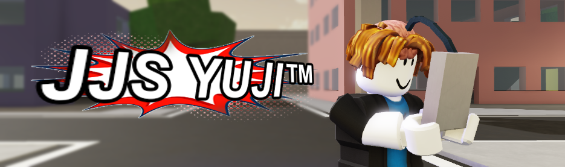
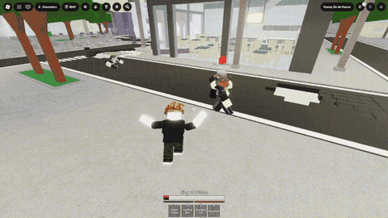
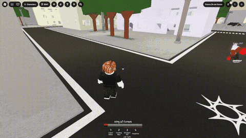
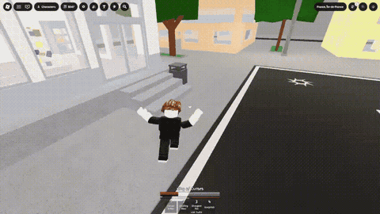
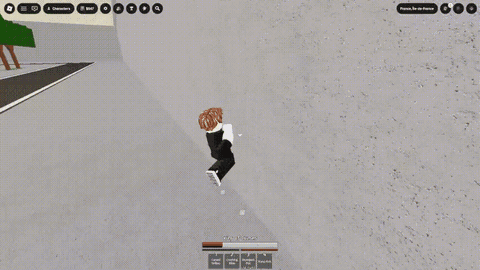
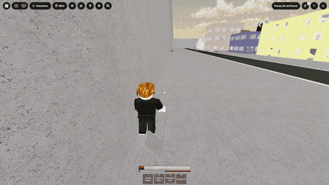
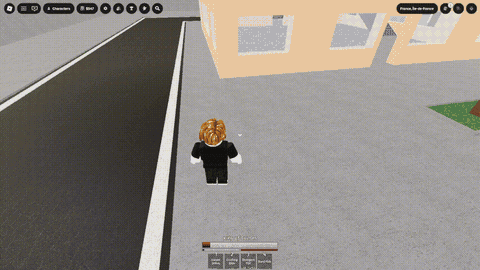

<p align="center">
  
</p>

<p align="center">An AI model that plays JJS (Jujutsu Shenanigans) using imitation learning (behavioral cloning).</p>

<!-- DEMO VIDEO PLACEHOLDER -->

> **Disclaimer:** This repository is for educational and research purposes only. Using bots or automation in Roblox may violate the [Roblox Terms of Use](https://en.help.roblox.com/hc/en-us/articles/115004647846) and can get your account banned. I am not responsible for any consequences of using this code, including account bans or any other damages. Use it at your own risk.

**Built with technology from NXAI.** See [Licensing](#licensing).

## Contents
- [Requirements](#requirements)
- [Usage](#usage)
- [Architecture](#architecture)
- [Model state](#model-state)
- [Examples](#examples)
- [Limitations](#limitations)
- [Technical report](#technical-report)
- [Note](#note)
- [Licensing](#licensing)

## Requirements
- Linux only
- A CUDA GPU
- Roblox via Sober (Flatpak `org.vinegarhq.Sober`)
- OBS (virtual camera for Roblox)

```bash
pip install -r requirements.txt
```

## Usage
### Settings
Run `python gui.py` to pick your camera, mouse and keyboard and change the other settings. It creates `config.json` on first run, and both `recorder.py` and `inference.py` read from it. You can also edit `config.json` directly once it's created.

If your mouse or keyboard doesn't show up (e.g. on a laptop or with a keyboard+touchpad combo), untick **Strict device filter**.

### Run the pretrained model
1. Download [`model.pt`](https://huggingface.co/TheZeez/jjs-yuji/blob/main/model.pt) into the repo root.
2. In `gui.py`, set the camera to your capture device (OBS virtual camera or whatever capturing Roblox).
3. Run `python inference.py`. Press `Ctrl+Alt+X` to stop.

### Train your own
Run the scripts in this order. Recording settings come from `config.json`, the other folder names are hard-coded at the top of each script.
1. `recorder.py`: records video + inputs at 30fps to `recorded/` (`Ctrl+Alt+X` to stop)
2. `prepare_data.py`: extracts DINOv3 features from `dataset/` (move/rename `recorded/` to it) into `outputs_gen/`
3. `int8_quantize.py`: quantizes the features into `outputs_gen_int8/` (required, `train.py` expects quantized features)
4. `train.py`: trains and saves `output_model.pt` (set the checkpoint to it in `gui.py` to use it)

## Architecture
| | |
|---|---|
| **Control** | `evdev`: input recording with `InputDevice.read()` and execution with `UInput` |
| **Vision** | `timm`, DINOv3 S (`vit_small_patch16_dinov3.lvd1689m`) |
| **Model** | two bare mLSTM layers (1024 -> 1024) from xLSTMLarge ([original repo](https://github.com/NX-AI/xlstm)) |
| **Resolution** | 432x240 |

## Model state
The model is decent. It's unpurposed, so it does everything only if you start it (e.g., you start a combo, it continues it). However, since it was trained on only 3 hours, it does only things it's confident in, which is mostly parkour and navigation. It can also be so random. I ended here because I don't have time for data recording because I'm in uni :')

## Examples
### Combat
*it mostly was getting cooked tbh*





### Parkour and navigation
*it's decent in this*





## Limitations
Since it was trained on only 3 hours of unpurposed data, we can't expect it to generalize very well or to correct itself in all situations. Also, it was only trained using the character *Vessel*.

*freezing*



*nudging unfreezes it*



## Technical report
The full experiment log is in [REPORT.md](REPORT.md).

## Note
AI was used only for GUI, boilerplate, and debugging.

## Licensing
This project uses third-party code and models with their own licenses:

- **xLSTM** ([NX-AI/xlstm](https://github.com/NX-AI/xlstm)): the `xlstm` package is Apache-2.0. Its kernels come from `mlstm_kernels`, which is under the **NXAI Community License** ([NXAI_LICENSE](NXAI_LICENSE)). Built with technology from NXAI.
- **OpenAI Video-Pre-Training** ([openai/Video-Pre-Training](https://github.com/openai/Video-Pre-Training)): the mu-law `CameraQuantizer` in `internal/mu.py` is adapted from it under the MIT License.
- **DINOv3** (`vit_small_patch16_dinov3.lvd1689m` via `timm`): weights are downloaded at runtime and are under the [DINOv3 License](https://ai.meta.com/resources/models-and-libraries/dinov3-license) by Meta. They are not included in this repo.

See [NOTICE](NOTICE) for the full attribution notices.
