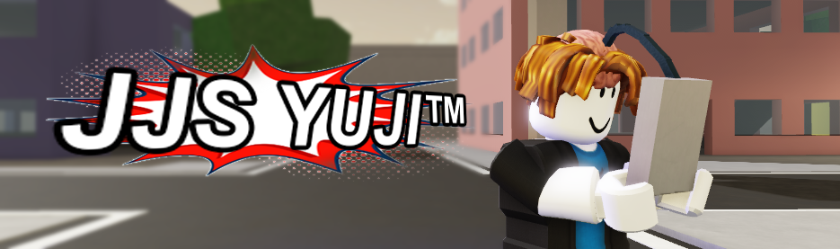

<p align="center">
  
</p>

<p align="center">An AI model that plays JJS (Jujutsu Shenanigans) using imitation learning (behavioral cloning).</p>


https://github.com/user-attachments/assets/5384607e-0359-4805-9815-eb08b6f61deb


> **Disclaimer:** This repository is for educational and research purposes only. Using bots or automation in Roblox may violate the [Roblox Terms of Use](https://en.help.roblox.com/hc/en-us/articles/115004647846) and can get your account banned. Use it at your own risk.

## Contents
- [Requirements](#requirements)
- [Usage](#usage)
- [Architecture](#architecture)
- [Model state](#model-state)
- [Limitations](#limitations)
- [Technical report](#technical-report)
- [AI usage](#ai-usage)
- [Licensing](#licensing)

## Requirements
- Linux only
- A CUDA GPU
- Roblox via Sober (Flatpak `org.vinegarhq.Sober`)
- In the experience [Catalog Avatar Creator](https://www.roblox.com/games/7041939546/Catalog-Avatar-Creator), go to *Outfits* -> *Discover*, down you will find *Outfit Code*, enter `FA5E6B`. Then *Save to Roblox* to use the avatar. Without this, the model wouldn't be able to distinguish you from enemies.
- OBS (virtual camera for Roblox)
- Access to input devices:
  - Recording reads `/dev/input`, add yourself to the `input` group (then log out and back in): 
    ```bash
    sudo usermod -aG input $USER
    ```
  - Playing writes to `/dev/uinput`. If you have Steam installed this already works, otherwise add a udev rule:
    ```bash
    echo 'KERNEL=="uinput", SUBSYSTEM=="misc", TAG+="uaccess", OPTIONS+="static_node=uinput"' | sudo tee /etc/udev/rules.d/60-uinput.rules
    sudo udevadm control --reload && sudo udevadm trigger --sysname-match=uinput
    ```

```bash
pip install -r requirements.txt
```

## Usage
### GUI
Run `python gui.py`. Each tab (**Record**, **Play**, **Model**) has its own settings, saved to `config.json` (created on first run). `recorder.py` and `inference.py` read from it too, and you can also edit it directly.

If your mouse or keyboard doesn't show up (e.g. on a laptop or with a keyboard+touchpad combo), untick **Strict device filter** in the Record tab.

### Run the pretrained model
1. Download [`jjs-yuji-2.pt`](https://huggingface.co/TheZeez/jjs-yuji-2/blob/main/jjs-yuji-2.pt) into the repo root.
2. In the **Play** tab, set the camera to your capture device (OBS virtual camera or whatever is capturing Roblox).
3. Press **Start** or `Ctrl+Alt+Z` (it loads the model first if it isn't loaded). Press `Ctrl+Alt+X` to stop.

Or run `python inference.py` without the GUI.

### Train your own
Record data using the recorder in GUI, `python prepare_data.py` to convert your data to int8 `.pt` files, and `python train.py` to train + `python validate.py` to validate your training. Make sure to edit constants in the files (decoupled from config intentionally).

## Architecture
| | |
|---|---|
| **Control** | `evdev`: input recording with `InputDevice.read()` in threads and execution with `UInput` (mouse moves spread over the frame) |
| **Vision** | `timm`, DINOv3 S (`vit_small_patch16_dinov3.lvd1689m`), frozen, features stored as `int8` |
| **Resolution** | 432x240 at 30 fps (DINO map: 384 x 15 x 27) |
| **Model** | ConvLSTM2D (256 filters) -> 1x1 conv to 4 channels -> flatten -> Linear 512 -> x + SwiGLU(norm x) -> norm -> key and mouse heads (8.7M params) |

## Model state
The model is now a lot better than previous release. It has a clear purpose (to win 1v1) and it has more data (9h vs previous 3h).

## Limitations
With 9 hours of data, it's basically a newborn. When facing real players with even a single brain cell, expect it to choke a lot. It sometimes mistakes spawn blocks or literally nothing for players and starts beefing with air (figh club). The project's purpose isn't a good model but learning how to make one, and the only ceiling now is the amount of data. Also, the model was only trained using the character *Vessel*, which is Itadori Yuji.

## Technical report
The full experiment log is in [REPORT.md](REPORT.md).

## AI usage
AI was used for making ConvLSTM class, test scripts, GUI, boilerplate, and debugging.

## Licensing
This project uses third-party code and models with their own licenses:

- **DINOv3** (`vit_small_patch16_dinov3.lvd1689m` via `timm`): weights are downloaded at runtime and are under the [DINOv3 License](https://ai.meta.com/resources/models-and-libraries/dinov3-license) by Meta. They are not included in this repo.

See [NOTICE](NOTICE) for the full attribution notices.
